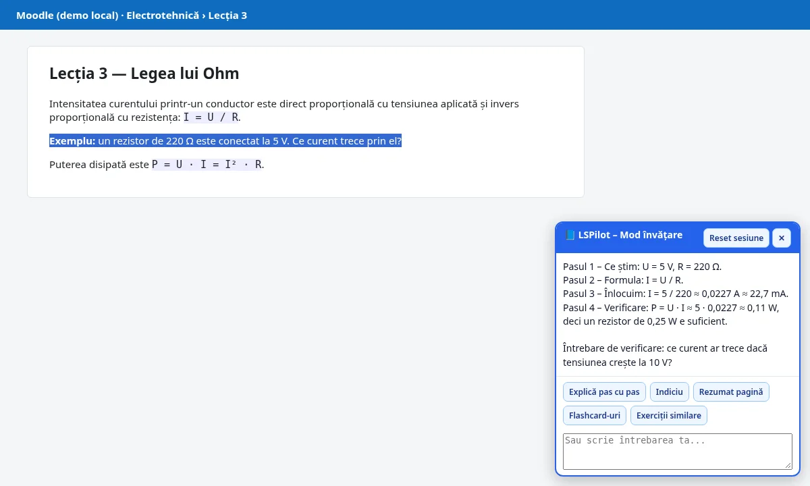
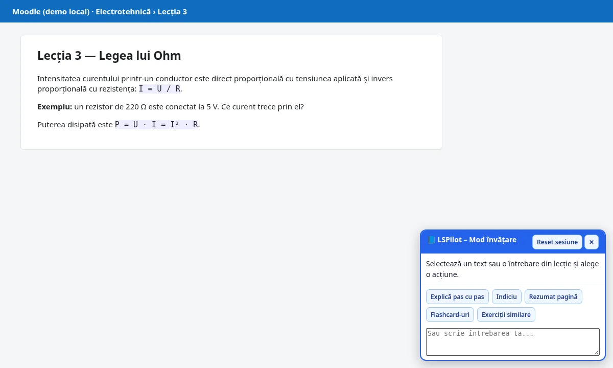
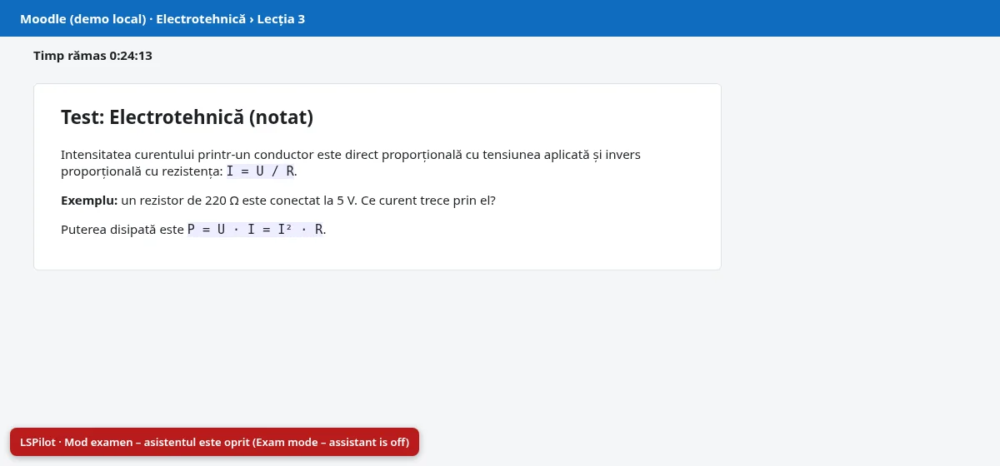
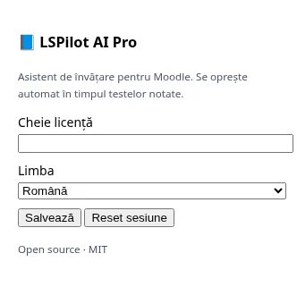
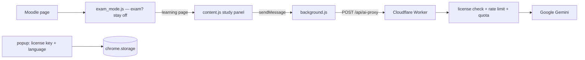

<div align="center">

<br>

# LSPilot

**A tutor-style study panel for Moodle that switches itself off during graded exams.**

  <a href="https://lspilot-demo.vercel.app"></a>
  <a href="https://github.com/LucianCeusanRo/lspilot/actions/workflows/ci.yml"></a>
  <a href="LICENSE"></a>
  
  <a href="https://github.com/LucianCeusanRo/lspilot/stargazers"></a>
  <a href="https://github.com/LucianCeusanRo/lspilot/commits/main"></a>

[English](#-about) · [Română](#-română)

</div>

<p align="center"></p>

<p align="center"><strong><a href="https://lspilot-demo.vercel.app">▶ Live demo</a></strong> — open it in the browser and try it yourself.</p>

## 📑 Table of contents

- [📖 About](#-about)
- [✨ Features](#-features)
- [🧠 How it works](#-how-it-works)
- [⚡ Quick start](#-quick-start)
- [📚 Step-by-step tutorial](#-step-by-step-tutorial)
- [🔧 Configuration](#-configuration)
- [🗂️ Project structure](#-project-structure)
- [⚠️ Limitations](#-limitations)
- [❓ FAQ](#-faq)
- [🗺️ Roadmap](#-roadmap)
- [🤝 Contributing](#-contributing)
- [📄 License](#-license)
- [🇷🇴 Română](#-română)
- [👤 Author](#-author)

## 📖 About

LSPilot adds a small **study panel** to Moodle course pages. You select a piece of a lesson (or type a question) and ask for a step-by-step explanation, a hint, a summary, flashcards or similar practice exercises. On a quiz **review** page it can also turn your wrong answers into a personal practice set. During graded or proctored exams it **turns itself off** and shows a red "Exam mode" banner.

- **What:** a Manifest V3 extension (Chrome / Edge / Firefox 121+) plus the Cloudflare Worker backend that forwards the request to Google Gemini.
- **What it is used for:** understanding course material faster — "explain this formula", "give me one hint, not the answer", "make 8 flashcards from this page", "why was my answer wrong?".
- **Who it helps:** students using Moodle (high school, university, vocational courses) who want a tutor-style explanation while studying, and teachers who want a tool that respects exam rules (a teacher can force it off with `<meta name="lspilot-disable">` or allow it on a practice quiz with `<meta name="lspilot-allow">`).

## ✨ Features

| Action | What it does |
|---|---|
| Explică pas cu pas / Explain | Tutor-style explanation that ends with a check question, without just stating the final answer |
| Indiciu / Hint | One short hint, never the answer |
| Rezumat pagină / Summary | Bullet-point summary with key terms and formulas (selection or whole page) |
| Flashcard-uri | 8 Q/A flashcards |
| Exerciții similare | 3 new practice questions with solutions at the end |
| Învață din greșeli | On `/mod/quiz/review.php`: collects your wrong answers, explains them and builds a 5-question practice set |

- ✨ **Exam mode** (`exam_mode.js`): the assistant does not load on a quiz attempt (`/mod/quiz/attempt.php`), on graded submissions, inside Safe Exam Browser / LockDown / Respondus and similar, or when proctoring plugins (Proctorio, Honorlock, ProctorU, Examity…) are detected.
- 🔎 Languages: Romanian, English, German, Swiss German, French, Italian (popup).
- ⚙️ Local history (last 100 answers) in `chrome.storage.local`; *Reset sesiune* clears it.
- 📊 **Worker:** license-key check (fixed keys from `LICENSE_KEYS` or HMAC keys bound to an e-mail), per-minute rate limiting, daily quota, prompt de-duplication cache, an admin panel protected by salted password hashes, optional Stripe webhook and Romanian e-invoicing (FGO) hooks.

| Study panel | Exam mode | Popup |
|---|---|---|
|  |  |  |

*Screenshots are taken on a local demo page with the browser API stubbed — the answer text is a sample, not a live AI response.*

## 🧠 How it works



`exam_mode.js` runs first; on quiz attempts, graded submissions, secure exam browsers or proctoring plugins the panel never loads and a red banner is shown. Otherwise the panel sends the selected text with a tutor prompt to your Worker, which checks the license key and calls Gemini.

**Tech stack:** Vanilla JavaScript, Manifest V3, Cloudflare Workers + Wrangler, Google Gemini API.

## ⚡ Quick start

```bash
git clone https://github.com/LucianCeusanRo/lspilot.git && cd lspilot/worker
cp .dev.vars.example .dev.vars   # add GEMINI_API_KEY, HMAC_SECRET, LICENSE_KEYS
npx wrangler dev                 # http://127.0.0.1:8787/api/health
# then load ../extension as an unpacked extension
```

## 📚 Step-by-step tutorial

### 1. Deploy the backend (Cloudflare Worker)
```bash
git clone https://github.com/LucianCeusanRo/lspilot.git
cd lspilot/worker
npm install -g wrangler        # or: npx wrangler ...
wrangler login
cp .dev.vars.example .dev.vars # fill in values for local testing (git-ignored)
wrangler dev                   # local test at http://127.0.0.1:8787/api/health
```
Production secrets — never put them in the code:
```bash
wrangler secret put GEMINI_API_KEY     # from Google AI Studio
wrangler secret put HMAC_SECRET        # long random string
wrangler secret put LICENSE_KEYS       # e.g. LSP-CLASS-A1B2-C3D4,LSP-CLASS-E5F6-G7H8
wrangler deploy                        # prints https://lspilot-worker.<you>.workers.dev
```

### 2. Point the extension to your worker
Edit `extension/background.js`:
```js
const API_BASE = 'https://lspilot-worker.<you>.workers.dev';
```
(If you use a custom domain, also add it to `host_permissions` in `extension/manifest.json`.)

### 3. Load the extension
- Chrome / Edge: `chrome://extensions` → *Developer mode* → **Load unpacked** → choose the `extension/` folder.
- Firefox: `about:debugging` → *This Firefox* → **Load Temporary Add-on** → `extension/manifest.json`.

### 4. Use it
1. Click the extension icon, paste a license key from your `LICENSE_KEYS`, pick a language, press **Salvează**.
2. Open a Moodle lesson. A **📘 LSPilot** button appears bottom-right; click it.
3. Select a paragraph or a problem → **Explică pas cu pas** (or **Indiciu**, **Rezumat pagină**, …). You can also type your own question in the text box.
4. After a quiz, open its review page → **Învață din greșeli** for a personal practice set.
5. Start a graded quiz attempt: the panel does not appear and the red *Exam mode* banner is shown.

## 🔧 Configuration

Local: `worker/.dev.vars` (git-ignored). Production: `wrangler secret put NAME`.

| Variable | Required | What it does |
|---|---|---|
| `GEMINI_API_KEY` | yes | Google AI Studio key (or `GEMINI_API_KEYS` for rotation) |
| `HMAC_SECRET` | yes | signs session tokens and e-mail-bound license keys |
| `LICENSE_KEYS` | yes (v5 extension) | comma-separated keys your users paste in the popup |
| `OWNER_LICENSE_KEY` | no | your own key |
| `ALLOW_ANONYMOUS` | no (0) | 1 = accept requests without a key (uses your AI quota!) |
| `ADMIN_EMAIL / ADMIN_PASSWORD_SALT / ADMIN_PASSWORD_HASHES` | no | admin panel login (SHA-256 of salt + password) |
| `STRIPE_WEBHOOK_SECRET` | no | only if you sell licenses with Stripe |
| `FGO_COD_UNIC / FGO_PRIVATE_KEY / FGO_SERIE` | no | only for Romanian e-invoicing (FGO) |
| `COMPANY_*` | no | invoice details shown by the admin panel |

## 🗂️ Project structure

```
extension/            manifest.json, background.js, content.js, content.css, exam_mode.js, popup.*, icons/
worker/worker.js      Cloudflare Worker (API, license check, quota, admin)
worker/wrangler.jsonc Wrangler config (add your own account)
worker/.dev.vars.example / .env.example   all settings as placeholders
docs/screenshots/     demo screenshots
```

## ⚠️ Limitations

- Needs your own Cloudflare account and Gemini API key; AI answers can be wrong — always check them against the course.
- The v5 extension sends only the license key, so use fixed keys in `LICENSE_KEYS` (e-mail-bound HMAC keys need the e-mail sent too).
- Quotas, sync data and rate limits live **in Worker memory** — they reset when the Worker instance restarts (no KV/D1 database yet).
- Exam detection is heuristic (URL patterns, known proctoring/SEB markers). It is a safety net, not a guarantee; follow your school's rules.
- The admin panel UI, the marketing website and the older desktop / iPad apps are not part of this repository.

---

## ❓ FAQ

<details><summary><b>Can it be used to cheat in exams?</b></summary>

It is designed not to: it does not load on quiz attempts, in Safe Exam Browser or with proctoring tools, and teachers can force it off with `<meta name="lspilot-disable">`.

</details>

<details><summary><b>Does it work without my own backend?</b></summary>

No. You deploy the Worker with your own Gemini key; the extension talks only to the URL you set in `background.js`.

</details>

<details><summary><b>What data is stored?</b></summary>

The last 100 answers in local extension storage; *Reset sesiune* clears them. The Worker keeps quotas in memory only.

</details>

## 🗺️ Roadmap

- [ ] Persistent quotas with Workers KV / D1
- [ ] Settings field for the API URL in the popup
- [ ] Chrome Web Store / Firefox AMO packaging

## 🤝 Contributing

Issues and pull requests are welcome. Please keep changes small, describe how you tested them, and never commit real credentials — use `.env` (git-ignored) and update `.env.example` with placeholders only.

## 📄 License

MIT — see [LICENSE](LICENSE).

## 🇷🇴 Română

<details>
<summary><b>Click pentru versiunea în limba română</b></summary>

LSPilot adaugă un **panou de studiu** pe paginile de curs Moodle. Selectezi o parte din lecție (sau scrii o întrebare) și ceri explicație pas cu pas, un indiciu, un rezumat, flashcard-uri sau exerciții similare. Pe pagina de **revizuire** a unui test transformă răspunsurile greșite într-un set personal de exerciții. În timpul testelor notate sau supravegheate **se oprește singur** și afișează banner-ul roșu „Mod examen”.

#### Ce este și la ce folosește
- **Ce:** extensie Manifest V3 (Chrome / Edge / Firefox 121+) + backend Cloudflare Worker care trimite cererea la Google Gemini.
- **La ce folosește:** să înțelegi mai repede materia — „explică formula asta”, „dă-mi doar un indiciu”, „fă 8 flashcard-uri din pagină”, „de ce am greșit?”.
- **Pe cine ajută:** elevi și studenți care folosesc Moodle și vor explicații ca de la un tutore, și profesori care vor un instrument care respectă regulile de examen (`<meta name="lspilot-disable">` îl oprește, `<meta name="lspilot-allow">` îl permite la un test de exersare).

#### Funcționalități
Explicație pas cu pas, Indiciu, Rezumat pagină, Flashcard-uri, Exerciții similare, Învață din greșeli (vezi tabelul de mai sus). Mod examen automat (test în desfășurare, Safe Exam Browser, pluginuri de proctoring). 6 limbi. Istoric local (ultimele 100 de răspunsuri). Worker cu verificare licență, limită pe minut, cotă zilnică, cache, panou admin cu parole hash-uite.

#### Arhitectură și tehnologii
JavaScript simplu, Manifest V3, Cloudflare Workers + Wrangler, Google Gemini API (vezi diagrama de mai sus).

#### Tutorial
1. **Backend:** `cd worker`, `wrangler login`, `cp .dev.vars.example .dev.vars`, `wrangler dev`; în producție `wrangler secret put GEMINI_API_KEY`, `HMAC_SECRET`, `LICENSE_KEYS`, apoi `wrangler deploy`.
2. **Extensia:** în `extension/background.js` pune adresa worker-ului tău în `API_BASE`.
3. **Încărcare:** `chrome://extensions` → *Developer mode* → **Load unpacked** → folderul `extension/` (Firefox: `about:debugging` → *Load Temporary Add-on*).
4. **Utilizare:** din popup pui cheia de licență și limba → **Salvează**; pe o lecție Moodle apeși **📘 LSPilot**, selectezi textul și alegi acțiunea; după test, pe pagina de revizuire, **Învață din greșeli**. La un test notat panoul nu apare.

#### Structura proiectului
`extension/` (extensia), `worker/` (backend + configurare), `docs/screenshots/` (capturi demo).

#### Limitări
- Ai nevoie de cont Cloudflare și cheie Gemini proprii; răspunsurile AI pot greși.
- Extensia v5 trimite doar cheia, deci folosește chei fixe în `LICENSE_KEYS`.
- Cotele și datele de sincronizare stau în memoria Worker-ului și se resetează la repornire.
- Detecția examenului e euristică — o plasă de siguranță, nu o garanție. Respectă regulile școlii.
- Panoul admin, site-ul de prezentare și aplicațiile vechi desktop/iPad nu fac parte din acest repo.

</details>

## 👤 Author

**Lucian-Ciprian Ceușan** — telecom & network technician, Bucharest, Romania

[](https://lucian-ceusan.vercel.app) [](https://www.linkedin.com/in/lucian-ceusan-7a9179210) [](https://github.com/LucianCeusanRo)
